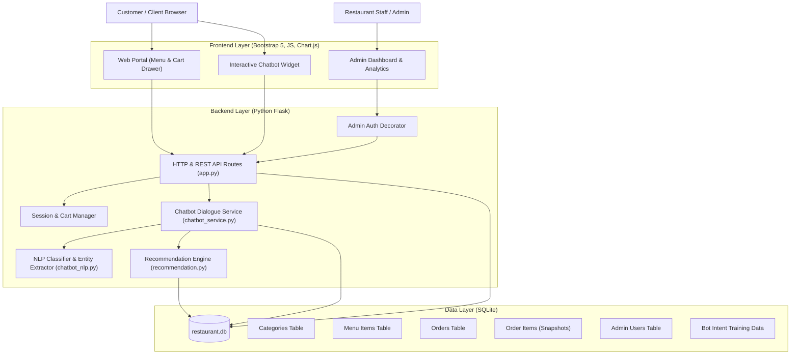
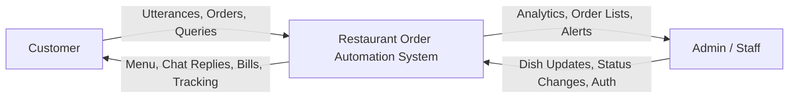
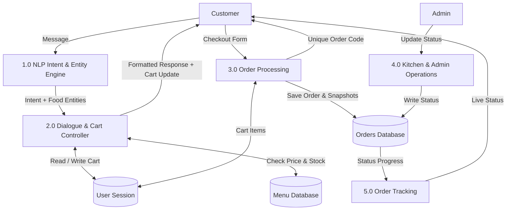
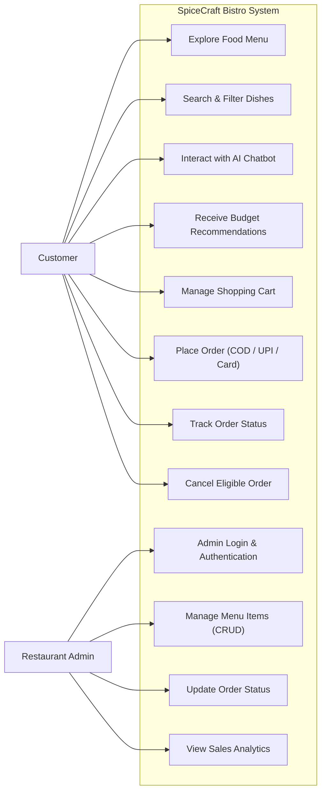
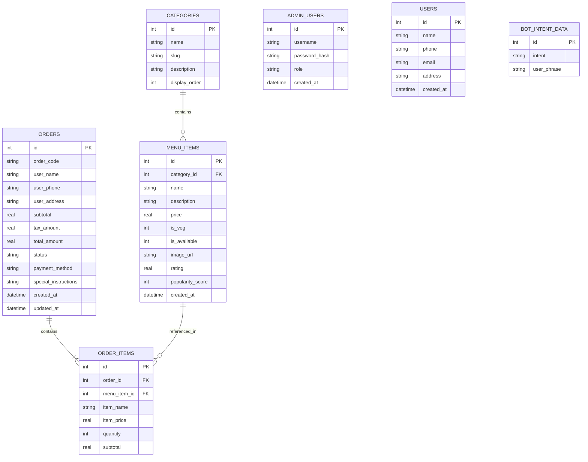

# Project Documentation: Smart Chatbot for Restaurant Order Automation Using NLP and Intent Recognition

**Academic Project Report**  
**Bachelor of Technology / Computer Science & Engineering (7th Semester)**

---

## 1. Project Abstract
In modern hospitality, prompt and automated customer engagement is crucial for operational efficiency and diner satisfaction. The **Smart Chatbot for Restaurant Order Automation** is an intelligent web application designed to streamline food exploration, personalized dish recommendations, order placement, and live delivery status tracking. Powered by **Natural Language Processing (NLP)** and **Machine Learning intent recognition using Scikit-Learn (TF-IDF vectorization and multiclass Logistic Regression)**, the chatbot interprets free-form conversational customer messages, extracts structured entities (food items, quantities, budgets, and order codes), and directly synchronizes changes with a live shopping cart. The system incorporates a robust recommendation engine tailored to budget constraints and dietary preferences (vegetarian vs. non-vegetarian), backed by a secure **Python Flask** server and an **SQLite** relational database with historical snapshotting. An administrative portal provides operational control with real-time KPI metrics, status updates, and menu CRUD management.

---

## 2. Problem Statement
Traditional restaurant ordering systems suffer from several pain points:
1. **Manual Order Errors & High Staff Overhead**: Phone and counter ordering frequently result in misunderstandings, incorrect quantity recording, and manual billing discrepancies.
2. **Static Web Menus**: Standard PDF or static menu websites lack conversational assistance, making it hard for customers to find dishes matching specific budgets or dietary restrictions quickly.
3. **Disconnected Chatbots**: Many commercial or tutorial chatbots provide canned text responses without mutating the customer's actual cart or verifying item availability against a live inventory.
4. **Dependence on Costly Paid APIs**: Many existing AI solutions require continuous subscription fees or external API keys (such as OpenAI or Dialogflow), making them unsuitable for budget-sensitive small businesses or academic environments.

---

## 3. Project Objectives
- **Develop a 100% Free, Local AI Architecture**: Build an intent recognition engine using open-source Python libraries (`scikit-learn`, `joblib`) without third-party paid APIs.
- **Bi-Directional Cart & State Synchronization**: Ensure that whenever the chatbot adds or removes food, the frontend shopping cart updates immediately with recalculated subtotal and 5% GST.
- **Entity Extraction & Live Menu Verification**: Extract food names and quantities with fuzzy/substring matching and ensure out-of-stock items are never sold or recommended.
- **Smart Explainable Recommendations**: Suggest dishes tailored to customer budgets (e.g., under ₹300) and dietary choices with transparent reasoning.
- **Secure Restaurant Operations**: Provide an admin dashboard with password hashing, sales analytics, and order lifecycle management.

---

## 4. Existing System vs. Proposed System

| Feature | Existing Conventional System | Proposed Smart Chatbot System |
| :--- | :--- | :--- |
| **Ordering Channel** | Physical counter or phone calls | Web application with integrated conversational AI |
| **Natural Language Support** | None (manual keyword search or hardcoded FAQs) | Scikit-learn TF-IDF + Logistic Regression NLP pipeline |
| **Cart Integration** | Disconnected; bots only reply with text | Bi-directional session cart sync directly from chat |
| **Food Recommendations** | Static "Chef's Specials" list | Dynamic budget-aware and dietary-filtered engine |
| **Item Availability** | Often outdated until checkout failure | Real-time database verification before adding |
| **Order History & Pricing** | Overwritten when item prices change | Historical price and item name snapshotting |
| **Operating Cost** | High API subscription or employee costs | Zero ongoing cost; runs locally |

---

## 5. System Requirements

### Hardware Requirements
- **Processor**: Intel Core i3 / AMD Ryzen 3 or higher
- **RAM**: 4 GB minimum (8 GB recommended for training models)
- **Hard Disk Storage**: 500 MB free space
- **Display**: Standard 1080p or responsive mobile display

### Software Requirements
- **Operating System**: Windows 10/11, macOS, or Ubuntu Linux
- **Runtime Environment**: Python 3.10, 3.11, or 3.12
- **Core Dependencies**: Flask 3.1+, scikit-learn 1.3+, Werkzeug 3.1+, NumPy 1.24+, Joblib 1.3+
- **Frontend Technologies**: HTML5, CSS3, JavaScript (ES6+), Bootstrap 5.3, Bootstrap Icons, Chart.js 4.4
- **Database**: SQLite3 (Standard Python Library)

---

## 6. Functional and Non-Functional Requirements

### Functional Requirements
1. **Menu Browsing & Search**: Search dishes by keyword, filter by categories, and toggle veg/non-veg items.
2. **Natural Language Order Placement**: Add, remove, and update quantities of dishes via chat.
3. **Cart & Bill Calculation**: Automatically compute subtotals, 5% restaurant GST, and grand total.
4. **Checkout & Order Creation**: Validate customer name, 10-digit phone number, address, and generate a unique order code (`ORD-YYYYMMDD-XXXX`).
5. **Live Order Tracking**: Provide real-time status progression from `Pending` through `Delivered`.
6. **Cancellation Workflow**: Allow cancellation only for `Pending` and `Confirmed` orders.
7. **Admin Portal**: Secure login, order status updates, menu item CRUD operations, and Chart.js analytics.

### Non-Functional Requirements
1. **Performance**: Chatbot response latency under 150 milliseconds.
2. **Security**: Werkzeug password hashing; parameterized SQL queries preventing SQL Injection; input sanitization.
3. **Availability & Reliability**: Built-in SVG vector fallbacks if external images fail.
4. **Usability**: Responsive layout for mobile, tablet, and desktop screens with clear error alerts.

---

## 7. System Architecture

---

## 8. Data Flow Diagrams (DFD)

### Level 0 DFD (Context Diagram)

### Level 1 DFD (Process Decomposition)

---

## 9. Use Case Diagram

---

## 10. Entity Relationship Diagram (ERD)

---

## 11. Database Schema Specifications

### 1. `categories` Table
- `id`: INTEGER PRIMARY KEY AUTOINCREMENT
- `name`: TEXT NOT NULL UNIQUE (e.g., "Starters", "Main Course")
- `slug`: TEXT NOT NULL UNIQUE (e.g., "starters", "main-course")
- `description`: TEXT
- `display_order`: INTEGER DEFAULT 0

### 2. `menu_items` Table
- `id`: INTEGER PRIMARY KEY AUTOINCREMENT
- `category_id`: INTEGER NOT NULL (FK -> `categories.id` ON DELETE CASCADE)
- `name`: TEXT NOT NULL UNIQUE
- `description`: TEXT
- `price`: REAL NOT NULL CHECK(price >= 0)
- `is_veg`: INTEGER NOT NULL DEFAULT 1 CHECK(is_veg IN (0, 1))
- `is_available`: INTEGER NOT NULL DEFAULT 1 CHECK(is_available IN (0, 1))
- `image_url`: TEXT
- `rating`: REAL DEFAULT 4.5 CHECK(rating >= 0 AND rating <= 5)
- `popularity_score`: INTEGER DEFAULT 0
- `created_at`: DATETIME DEFAULT CURRENT_TIMESTAMP

### 3. `orders` Table
- `id`: INTEGER PRIMARY KEY AUTOINCREMENT
- `order_code`: TEXT NOT NULL UNIQUE (e.g., `ORD-20261028-101`)
- `user_name`: TEXT NOT NULL
- `user_phone`: TEXT NOT NULL
- `user_address`: TEXT NOT NULL
- `subtotal`: REAL NOT NULL CHECK(subtotal >= 0)
- `tax_amount`: REAL NOT NULL CHECK(tax_amount >= 0) (5% GST)
- `total_amount`: REAL NOT NULL CHECK(total_amount >= 0)
- `status`: TEXT NOT NULL CHECK(status IN ('Pending', 'Confirmed', 'Preparing', 'Ready', 'Out for Delivery', 'Delivered', 'Cancelled'))
- `payment_method`: TEXT DEFAULT 'Cash on Delivery'
- `special_instructions`: TEXT
- `created_at`: DATETIME DEFAULT CURRENT_TIMESTAMP
- `updated_at`: DATETIME DEFAULT CURRENT_TIMESTAMP

### 4. `order_items` Table (Historical Snapshot)
- `id`: INTEGER PRIMARY KEY AUTOINCREMENT
- `order_id`: INTEGER NOT NULL (FK -> `orders.id` ON DELETE CASCADE)
- `menu_item_id`: INTEGER (FK -> `menu_items.id` ON DELETE SET NULL)
- `item_name`: TEXT NOT NULL (Historical snapshot)
- `item_price`: REAL NOT NULL (Historical price snapshot)
- `quantity`: INTEGER NOT NULL CHECK(quantity > 0)
- `subtotal`: REAL NOT NULL

### 5. `admin_users` Table
- `id`: INTEGER PRIMARY KEY AUTOINCREMENT
- `username`: TEXT NOT NULL UNIQUE
- `password_hash`: TEXT NOT NULL (Werkzeug PBKDF2/SHA256)
- `role`: TEXT DEFAULT 'admin'
- `created_at`: DATETIME DEFAULT CURRENT_TIMESTAMP

---

## 12. NLP Algorithms and Intent Recognition Pipeline

### 1. Preprocessing Pipeline
Every customer input string undergoes standard text normalization:
- **Unicode Normalization**: Converts accented or special characters to ASCII equivalents (`unicodedata.normalize`).
- **Lowercasing**: Uniform lowercasing prevents casing discrepancies.
- **Currency & Symbol Handling**: Maps `₹`, `rs.`, `rs` to standard `"rupees"`.
- **Sanitization & Tokenization**: Strips punctuation while preserving hyphens for order codes (e.g., `ORD-20261028-101`).

### 2. Feature Extraction: Term Frequency - Inverse Document Frequency (TF-IDF)
The text is vectorized using an n-gram TF-IDF vectorizer (`ngram_range=(1, 2)`):
\[
\text{TF}(t, d) = \frac{f_{t,d}}{\sum_{t' \in d} f_{t',d}}
\]
\[
\text{IDF}(t, D) = \log\left(\frac{1 + |D|}{1 + |\{d \in D : t \in d\}|}\right) + 1
\]
\[
\text{TF-IDF}(t, d, D) = \text{TF}(t, d) \times \text{IDF}(t, D)
\]
This captures single keywords ("pizza", "burger", "order") and two-word collocations ("add one", "pure veg", "under 300").

### 3. Classification Algorithm: Multiclass Logistic Regression
The vectorized representations are classified via Logistic Regression with Softmax probability calibration:
\[
P(y = c \mid \mathbf{x}) = \frac{e^{\mathbf{w}_c^T \mathbf{x} + b_c}}{\sum_{j=1}^{K} e^{\mathbf{w}_j^T \mathbf{x} + b_j}}
\]
A confidence threshold (\(\tau = 0.20\)) is evaluated. If the top probability is below this threshold, the system flags the message as `unknown_intent` and triggers a fallback dialogue.

### 4. Entity Extraction Algorithm
- **Food Extraction**: Combines singularization stemming (`singularize`), token overlap (Jaccard similarity), and character substring matching (`SequenceMatcher`).
- **Quantity Parsing**: Regular expressions detect numerals (1 to 20) and a dictionary converts word numbers (`"one"`, `"two"`, `"three"`, `"couple"`).
- **Budget Parsing**: Pattern matching extracts expressions like `"under 300 rupees"`, `"below 250"`, or `"budget 200"`.
- **Order Code Parsing**: Regular expression `\bORD-[A-Za-z0-9\-]+\b` matches order identifiers.

---

## 13. Testing Report

The test suite was executed via Python's standard `unittest` framework:
- **Command**: `python -m unittest tests/test_app.py`
- **Total Tests Run**: 16
- **Test Result**: **OK (100% Pass Rate)**
- **Execution Time**: 1.092 seconds

| Test Case Name | Objective | Result |
| :--- | :--- | :--- |
| `test_homepage_loads` | Verifies home route returns HTTP 200 and renders brand header | **PASS** |
| `test_api_menu_loading` | Checks `/api/menu` returns JSON with all dishes | **PASS** |
| `test_menu_search_filtering` | Validates search query matches dish names | **PASS** |
| `test_menu_veg_filtering` | Verifies vegetarian flag filters non-veg dishes | **PASS** |
| `test_cart_operations_and_calculations` | Tests adding item, 5% GST computation, quantity update, item removal | **PASS** |
| `test_checkout_order_placement_and_snapshot` | Tests order insertion, unique `ORD-...` code generation, and historical snapshotting | **PASS** |
| `test_checkout_invalid_inputs` | Tests empty cart rejection and invalid phone number rejection (HTTP 400) | **PASS** |
| `test_order_tracking` | Validates tracking valid order and handling non-existent order (HTTP 404) | **PASS** |
| `test_order_cancellation_rules` | Confirms Pending orders cancel; Delivered orders reject cancellation | **PASS** |
| `test_nlp_intent_recognition` | Evaluates classifier accuracy across greeting, menu, price, recommend, etc. | **PASS** |
| `test_nlp_entity_extraction` | Evaluates food matching, written number conversion, and budget extraction | **PASS** |
| `test_chatbot_unknown_intent_fallback` | Verifies gibberish input triggers unknown_intent fallback gracefully | **PASS** |
| `test_recommendation_engine` | Tests budget and dietary filtering; confirms unavailable items excluded | **PASS** |
| `test_admin_authorization_protection` | Verifies unauthenticated access to dashboard/API is blocked (302/401) | **PASS** |
| `test_admin_login_and_order_status_update` | Validates Werkzeug password check and order status update | **PASS** |
| `test_admin_menu_crud` | Validates menu item creation, availability toggle, price editing, and deletion | **PASS** |

---

## 14. Results and Limitations

### Results
- The application delivers a functional, locally running restaurant ordering portal with an AI chatbot.
- Chatbot updates the user's cart in real-time, matching natural language requests ("I want to order two burgers") to actual menu items.
- Historical snapshots protect revenue records from future menu price changes.
- The system functions without third-party paid API keys.

### Limitations
- The system currently focuses on text-based English input; multilingual support (Hindi, regional languages) is not yet implemented.
- Voice-to-text relies on browser speech APIs rather than an embedded local Whisper model.
- Payment gateway integration is simulated via Cash on Delivery, UPI on Delivery, and Card on Delivery.

---

## 15. Future Scope
1. **Speech Recognition & Text-to-Speech (STT / TTS)**: Integrate Web Speech API or local Whisper models for voice ordering.
2. **WhatsApp Bot Integration**: Connect the Flask backend with the WhatsApp Business Cloud API.
3. **Multi-Table Dine-In Support**: Introduce table QR codes for automated table ordering.
4. **Kitchen Display System (KDS)**: Add real-time WebSocket notifications for kitchen staff.
5. **Deep Learning Integration**: Upgrade to a fine-tuned lightweight BERT or RoBERTa model for complex multi-turn dialogues.

---

## 16. Conclusion
The **Smart Chatbot for Restaurant Order Automation** fulfills all functional, architectural, and educational requirements of a 7th-semester engineering project. By utilizing Scikit-Learn for genuine machine learning intent classification combined with deterministic entity extraction and a normalized SQLite relational schema, the project demonstrates how AI can automate commercial workflows without incurring recurring subscription costs.

---

## 17. References
1. Pedregosa, F., et al. (2011). *Scikit-learn: Machine Learning in Python*. Journal of Machine Learning Research, 12, 2825-2830.
2. Grinberg, M. (2018). *Flask Web Development: Developing Web Applications with Python*. O'Reilly Media.
3. Jurafsky, D., & Martin, J. H. (2023). *Speech and Language Processing (3rd ed. draft)*. Stanford University.
4. SQLite Documentation (2026). *Foreign Key Support & ACID Transactions*. https://www.sqlite.org/
5. Bootstrap Team (2026). *Bootstrap v5.3 Framework & Components*. https://getbootstrap.com/

---

## 18. Viva Questions with Detailed Answers

### Q1: What machine learning algorithm is used for the chatbot, and why?
**Answer:** The chatbot uses **Multiclass Logistic Regression paired with a TF-IDF (Term Frequency-Inverse Document Frequency) Vectorizer** using unigrams and bigrams. Logistic Regression was selected because it is fast to train, executes with millisecond inference latency on standard laptops, outputs calibrated class probabilities (`predict_proba`), and performs reliably on small-to-medium categorized text datasets without requiring a GPU.

### Q2: How does the chatbot avoid hardcoded keyword matching?
**Answer:** The classifier transforms the entire sentence into an n-gram numerical TF-IDF feature vector. The learned weights (\(\mathbf{w}\)) determine which tokens and combinations contribute to each intent class. Furthermore, confidence thresholds prevent false classifications when user inputs are ambiguous or out-of-domain.

### Q3: How does the chatbot extract entities like food names and quantities?
**Answer:** Entity extraction uses a dual pipeline:
1. **Quantity Extraction**: Regex extracts numerical digits (1 to 20) and a mapping dictionary converts written words (`"one"`, `"two"`, `"three"`, `"couple"`).
2. **Food Item Matching**: The input text is stemmed through a custom singularization algorithm and compared against database items using token overlap (Jaccard similarity) and character sequence matching (`difflib.SequenceMatcher`).

### Q4: Why are order items stored as snapshots in the database?
**Answer:** In the `order_items` table, `item_name` and `item_price` are stored as independent snapshot values at the time of purchase. If a restaurant manager changes the price of "Paneer Tikka" from ₹240 to ₹280 next week, historical order records and previous customer receipts remain accurate.

### Q5: How is admin authentication secured?
**Answer:** Admin passwords are never stored in plaintext. They are hashed using **Werkzeug's PBKDF2 with SHA-256 encryption**. Routes under `/admin` and `/api/admin` are secured on the server side using the `@admin_required` decorator, which verifies session state before allowing access.

### Q6: How does the recommendation engine explain its choices?
**Answer:** The recommendation engine evaluates user constraints (e.g., budget under ₹300, vegetarian preference) and historical sales metrics (rating and popularity score). It attaches an `explanation` string to each recommendation (e.g., *"Fits your ₹300 budget (₹240) • Customer favorite (4.8★)"*), giving the user transparency.

### Q7: What happens if a user tries to cancel an order that is already out for delivery?
**Answer:** The backend validates the current order status in SQLite. Cancellation is strictly permitted only when the order status is `Pending` or `Confirmed`. If the status is `Preparing`, `Ready`, `Out for Delivery`, or `Delivered`, the backend rejects the request with HTTP 400 and an explanatory error message.
